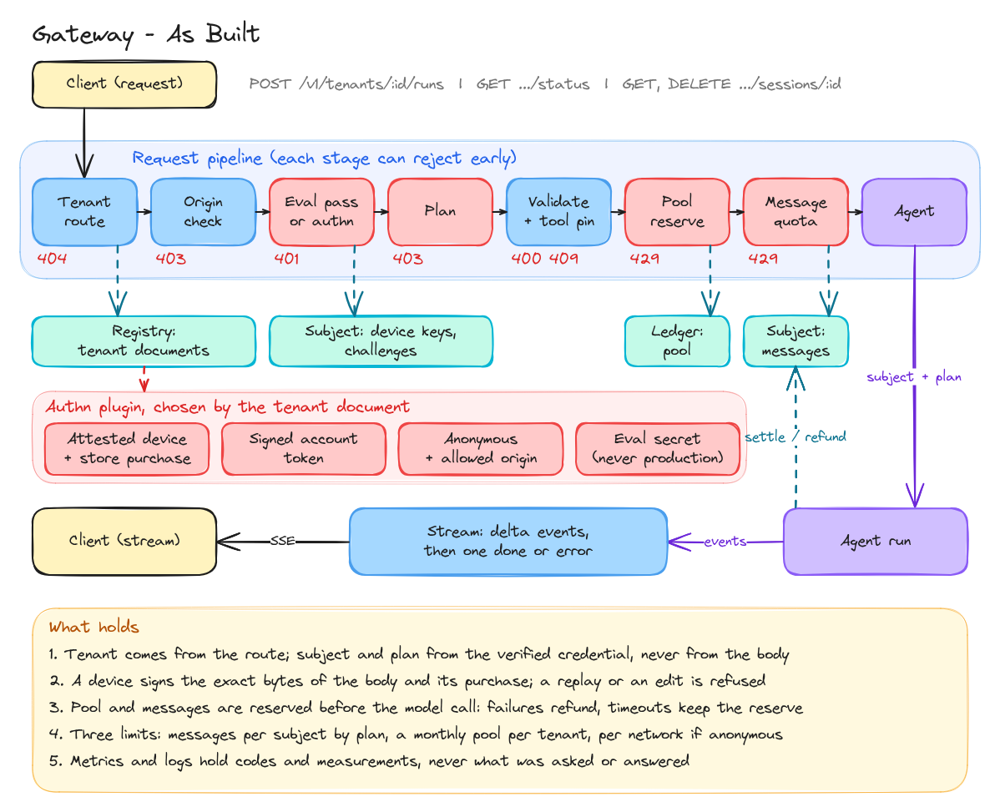
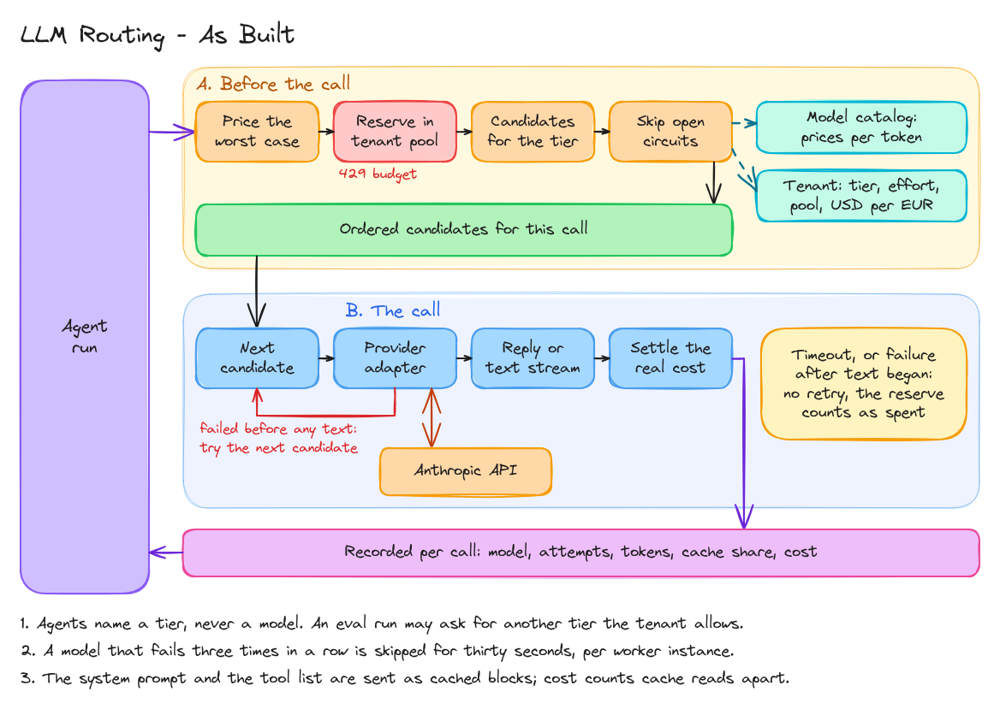

# agent-runtime

A multi-tenant agent runtime, built to learn how each module works and to reuse across projects.

It is TypeScript on Cloudflare Workers, with Durable Objects for state. Everything runs and is tested locally; nothing here has been deployed or run against a real model provider yet.

## Status

| Part          | Built                                                                                                                                                                                       | Not yet                                                       |
| ------------- | ------------------------------------------------------------------------------------------------------------------------------------------------------------------------------------------- | ------------------------------------------------------------- |
| Gateway       | Tenant routing, three authenticators (anonymous by allowed origin, signed account token, attested device with a store purchase), plans and entitlement, CORS, input validation, admin token | Per-user admin accounts                                       |
| Quota         | Per-network limits, a monthly pool per tenant in EUR with reserve and settle, monthly messages per subject by plan                                                                          | Metering embedding calls                                      |
| LLM routing   | Capability tiers, a provider adapter for Anthropic, fallback before any text is written, a circuit breaker per model, cost metering                                                         | A second provider                                             |
| Agents        | A gated question-and-answer agent, and a chat agent with tools, in stateless or stored mode                                                                                                 | Runtime-issued approval prompts                               |
| Tools         | Contracts pinned by hash, tools that run on the client, read-only fetch tools behind an egress allowlist, knowledge search                                                                  | Code-mode sandbox, tools with side effects run by the runtime |
| Sessions      | Stored conversations with ownership, a transcript, deletion, and a tool loop with a round limit                                                                                             |                                                               |
| Knowledge     | Per-tenant store, chunking, keyword and vector ranking, visibility per plan, document management                                                                                            | Reranking, very large corpora                                 |
| Observability | One record per request (codes and measurements only), aggregates, a dashboard                                                                                                               | Tracing, alerts                                               |

## Run it locally

You need Node 22.12 or later.

```bash
npm install
```

```bash
npm run demo
```

`npm run demo` starts a local worker with a fake model provider, loads the example tenant, sends a few requests, and prints the dashboard URL and its admin token. It needs no API key.

To talk to a real model, copy `.dev.vars.example` to `.dev.vars`, put a real key and a long random admin token in it, and run the worker:

```bash
npm run dev
```

Then load a tenant (the example is fictional; real tenants live with their products, never in this repository):

```bash
curl -X PUT http://localhost:8787/admin/api/tenants/demo \
  -H "authorization: Bearer $ADMIN_TOKEN" -H "content-type: application/json" \
  --data @examples/tenants/demo.tenant.json
```

`npm run check` runs formatting, lint, types, unit tests and the end-to-end tests. The end-to-end tests boot a local worker themselves.

## API

| Route                                                                   | What it does                                                                                                                                                                                            |
| ----------------------------------------------------------------------- | ------------------------------------------------------------------------------------------------------------------------------------------------------------------------------------------------------- |
| `POST /v1/tenants/:id/runs`                                             | Run the tenant's agent. The body depends on the agent kind (below). Answers as JSON, or as server-sent events (`delta`, then one `done` or `error`) when the request sends `Accept: text/event-stream`. |
| `GET /v1/tenants/:id/status`                                            | `{ "accepting": true }` while the tenant's monthly pool has room.                                                                                                                                       |
| `GET` / `DELETE /v1/tenants/:id/sessions/:sessionId`                    | Read the transcript of a stored session, or delete it. Owner only.                                                                                                                                      |
| `POST /v1/tenants/:id/attest/challenge`, `/attest/key`                  | Enroll a device key for a tenant that authenticates attested devices.                                                                                                                                   |
| `PUT /admin/api/tenants/:id`                                            | Create or replace a tenant. Returns the hash of each tool contract.                                                                                                                                     |
| `GET` / `PUT` / `DELETE /admin/api/tenants/:id/documents[/:documentId]` | Manage a tenant's knowledge documents.                                                                                                                                                                  |
| `GET /admin/api/metrics`                                                | Aggregates for the dashboard.                                                                                                                                                                           |
| `GET /admin`                                                            | The dashboard.                                                                                                                                                                                          |

Admin routes need the admin token. Errors are `{ "error": "<code>" }`, with a `message` and `retryAfterSeconds` where a person can act on them. Every response carries `x-request-id`.

### Request bodies

| Agent           | Body                                                                                                                                    | Reply                                               |
| --------------- | --------------------------------------------------------------------------------------------------------------------------------------- | --------------------------------------------------- |
| Gated           | `{ "messages": [{ "role": "user", "content": "..." }] }`                                                                                | `{ "onTopic", "answer" }`                           |
| Chat, stateless | `{ "contractVersion", "context", "messages" }`, where the client sends the whole conversation including tool calls and results          | `{ "stopReason", "content", "quota" }`              |
| Chat, stored    | `{ "contractVersion", "context", "sessionId"?, "message" }`, or `"toolResults"` in place of `"message"` to answer a pending client tool | `{ "sessionId", "stopReason", "content", "quota" }` |

A chat client may send `contractHash`; the runtime refuses the request if the tenant's tools no longer match it.

### Tenants

A tenant is one JSON document, validated by `src/tenants/schema.ts`. Two fictional examples show both shapes:

- `examples/tenants/demo.tenant.json`: anonymous callers, a gated agent.
- `examples/tenants/tutor.tenant.json`: signed account tokens, two plans, stored sessions, a fetch tool, knowledge search and a client tool.

Real tenants live with their products, never in this repository.

The runtime holds no product's rules. What differs between products is a tenant setting: how messages are counted, which prompt a contract version or client version gets, the wording of refusals and limits per language, which tools exist and where they run, which plans exist, and who may run evals.

## Evals

An eval suite asks a tenant real questions and grades what comes back, in code. `examples/evals/demo.cases.json` is a suite for the example tenant.

A tenant opts in with an `evals` block holding the SHA-256 of a secret of at least 32 characters. A runner that sends that secret is let in without an origin, a device or an account, gets its own subject per run and case, and receives a trace with each reply: the model, the model calls, the tools called and the cost. A tenant that serves production purchases cannot opt in.

```bash
EVAL_SECRET=... npm run evals -- --runtime http://localhost:8787 --tenant demo --cases examples/evals/demo.cases.json
```

The runner drives gated, stateless and stored tenants, answers client-run tools from the suite, prints the pass count per group and each failed check, compares against a saved baseline, and exits non-zero on a failure. `--runs 3` plays each case three times, `--tier` and `--effort` grade another model setting the tenant allows for evals. Real evals call the real model and cost money, so they are not part of `npm run check`.

Checks cover the tools called and what they were called with, the text and amounts of the answer, whether every amount of money came from a tool result or the question, the language, and time and model-call budgets. A case can attach one image.

A client that runs its own tools, such as a mobile app's test target, can use the same eval pass with its own runner: send `X-Eval-Secret` and `X-Eval-Run` in place of the usual credential.

## Working in this repository

`CLAUDE.md` has the ground rules: no comments in code, strict compiler and lint settings, and every feature ships with unit tests, an end-to-end spec and a verification skill in `.claude/skills/`.

## System design

A request enters through the gateway, which authenticates the caller and attaches a tenant context.
The agent core runs the plan, act, observe loop and calls the three other modules: LLM routing, the tools registry, and multi-tenant RAG.


Each diagram has an editable source in [`docs/design`](docs/design). Open the `.excalidraw` file at [excalidraw.com](https://excalidraw.com) or with the Excalidraw editor extension.

| Module           | Diagram                                    | Source                                                                         |
| ---------------- | ------------------------------------------ | ------------------------------------------------------------------------------ |
| Overview         | [PNG](docs/design/00-overview.png)         | [`00-overview.excalidraw`](docs/design/00-overview.excalidraw)                 |
| Gateway          | [PNG](docs/design/01-gateway.png)          | [`01-gateway.excalidraw`](docs/design/01-gateway.excalidraw)                   |
| Tools registry   | [PNG](docs/design/02-tools-registry.png)   | [`02-tools-registry.excalidraw`](docs/design/02-tools-registry.excalidraw)     |
| LLM routing      | [PNG](docs/design/03-llm-routing.png)      | [`03-llm-routing.excalidraw`](docs/design/03-llm-routing.excalidraw)           |
| Multi-tenant RAG | [PNG](docs/design/04-multi-tenant-rag.png) | [`04-multi-tenant-rag.excalidraw`](docs/design/04-multi-tenant-rag.excalidraw) |

## Tenants, subjects and plans

The runtime serves several products. Each product is a tenant, each end customer of a product is a subject, and each subject has a plan that sets its limits.

Tenants differ along four settings:

| Setting            | Options                                                                                                                  |
| ------------------ | ------------------------------------------------------------------------------------------------------------------------ |
| Authentication     | Device attestation plus a signed purchase, a signed account token carrying the plan, or anonymous with an allowed origin |
| Limits             | Messages per subject by plan, a monthly pool per tenant, and per IP for anonymous callers                                |
| Conversation state | Stored by the runtime, or stateless, where the client sends the history and nothing is kept                              |
| Tool execution     | In the runtime, on the client device, or no tools                                                                        |

The runtime does not own accounts or billing. Each product proves who the subject is and which plan they bought through its credential, and the runtime verifies that credential and enforces the plan.

## Gateway

The single entry point. A request passes through a pipeline where every stage can reject early, and the response comes back as a separate event stream.



- **Tenant route** picks the tenant, and with it the authenticator, plans and modes (404).
- **AuthN plugin** verifies the tenant's own credential against the raw request body (401).
- **Entitlement** reads the subject and its plan from the verified credential (402 when there is no active plan).
- **AuthZ** checks what the plan and scopes allow (403).
- **Validate and caps** checks the body, its size limits and the contract version, before any quota is spent (400).
- **Session mode** is per tenant: stored by the runtime with an ownership check (404), or stateless, where the client sends the history and nothing is kept.
- **Quota reserve** applies three limits: messages per subject by plan, a monthly pool per tenant, and per IP for anonymous callers (429). The reservation is settled after the run; a failed run is refunded and a timeout keeps it.
- **Dispatcher** hands the run and the subject context to the agent core.
- **Stream hub** fans events out over SSE. Reconnecting with `Last-Event-ID` works only in stored mode.

## Tools registry

Tools are registered once, shown to the model per tenant, and invoked through a pipeline that enforces policy in code.


- **Identity:** every tool has an owner and is addressed as `namespace/name@version#hash`, so names never collide.
- **Pinned by hash:** registration computes a sha256 over the definition, and invoke rejects any call whose hash no longer matches.
- **Discovery is read-only:** it resolves the tools for the tenant, the plan and the client's contract version, and never prompts.
- **One policy gate, at invoke time:** reads pass automatically; only write, external and irreversible calls ask for human approval, as a runtime prompt or on the device.
- **Secrets** are injected by the credential broker at execution and never enter the model context.
- **Client-run tools:** a tool can be marked to run on the client device. The runtime returns the call, the app runs it, and the result is validated when it comes back.
- **Sandbox tiers:** remote calls go through an egress allowlist proxy; model-written JavaScript runs in an isolate (QuickJS in WASM first, V8 isolates such as Cloudflare Dynamic Workers later); shell and file work runs in a microVM.

## LLM routing

Callers ask for a capability tier, never a model name. The router selects a model and then calls it inside a resilience loop.



- **Select:** normalize the request, drop models that cannot do the job (422), score the rest by cost, latency and tier, and reserve budget (429).
- **Call:** try the primary, respect circuit breakers and provider rate limits, and fall back down the ranked list on error or timeout.
- **Provider adapters** are the only place provider-specific code lives. Provider API keys are read from the secrets vault.
- **Sticky per run:** a run stays on one model so the provider's prompt cache stays warm.
- **Usage meter** records real token counts and cost and settles the budget reservation.
- **Two kinds of limit:** the router guards the tenant's monthly pool in EUR; message caps per subject live in the gateway.
- **Model settings per tenant:** thinking mode and output caps are part of tenant policy.
- **No silent retry** once tokens have streamed; the error goes back to the agent loop.

## Multi-tenant RAG

A write path that ingests documents and a read path that retrieves them, with four stores in between where every row carries a tenant id.


- **Ingest** runs in the background: stamp tenant and ACL, dedupe by content hash, parse, chunk, embed, and write to all stores.
- **Stores:** raw documents, metadata (the source of truth), a vector index with a namespace per tenant, and a keyword index.
- **Scope guard** forces the tenant and ACL filter onto every search in code. A query without a tenant fails.
- **Retrieve:** hybrid vector and keyword search, rerank, then pack chunks into a token budget with citations.
- **Retrieved text is untrusted data**, because documents can carry prompt injection.
- **Each chunk records its embedding model version**, and one search never mixes versions.
- **Optional per tenant:** a small corpus goes in the cached prompt or behind a fetch tool.

## Open decisions

- Platform and language.
- How a web product proves an account and its plan to the runtime. Drawn as a signed token issued by the product's backend.
- Tenant isolation in RAG: a shared index with a namespace per tenant (drawn) or a separate index per tenant.
- Whether the dispatcher calls the agent core directly (drawn) or through a queue.
