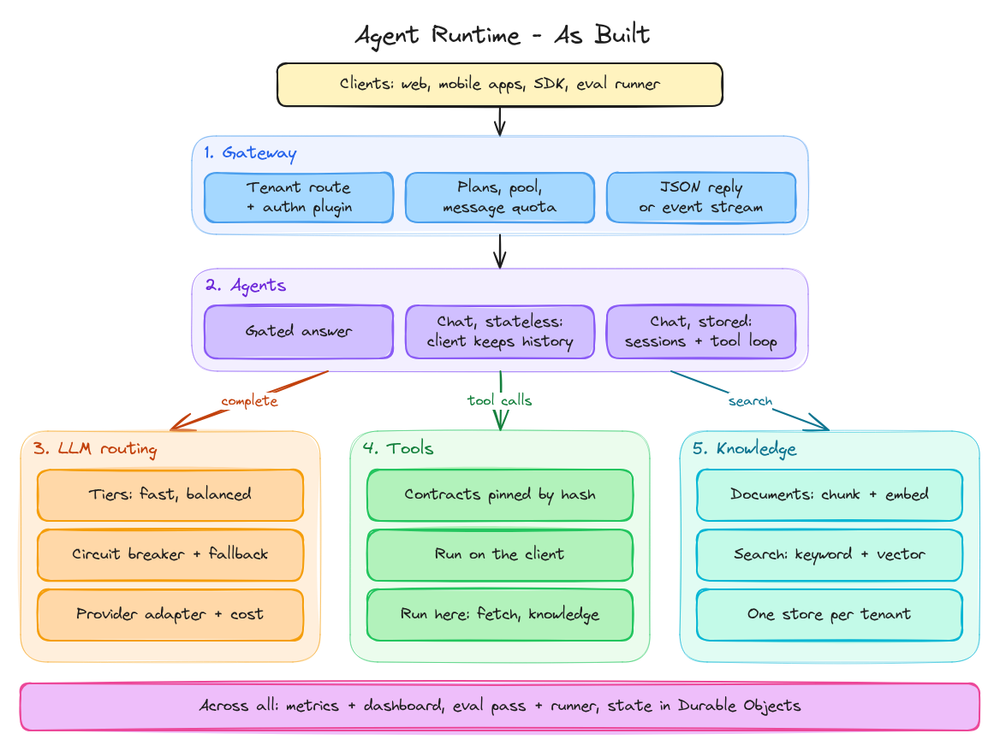
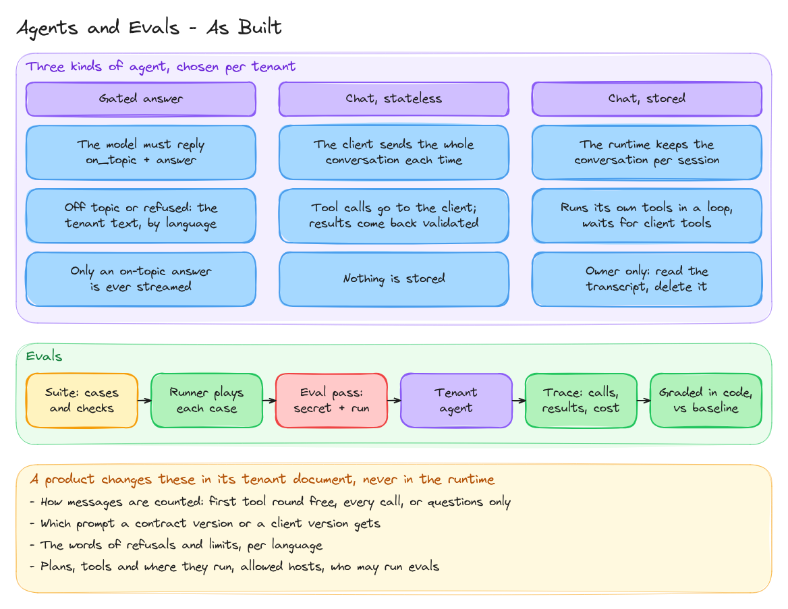
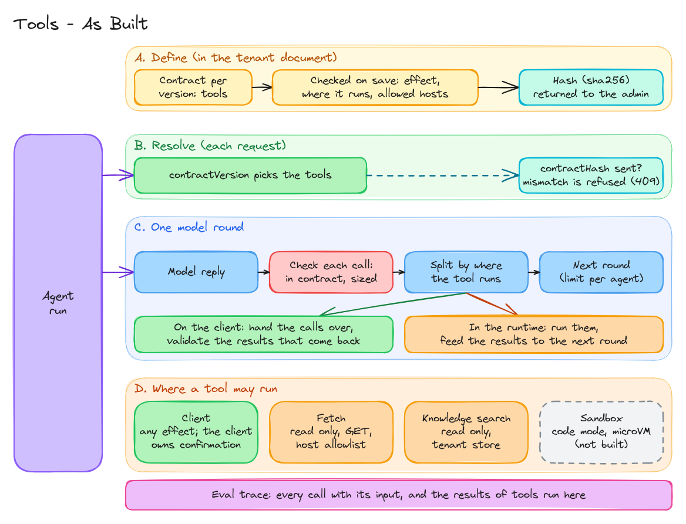
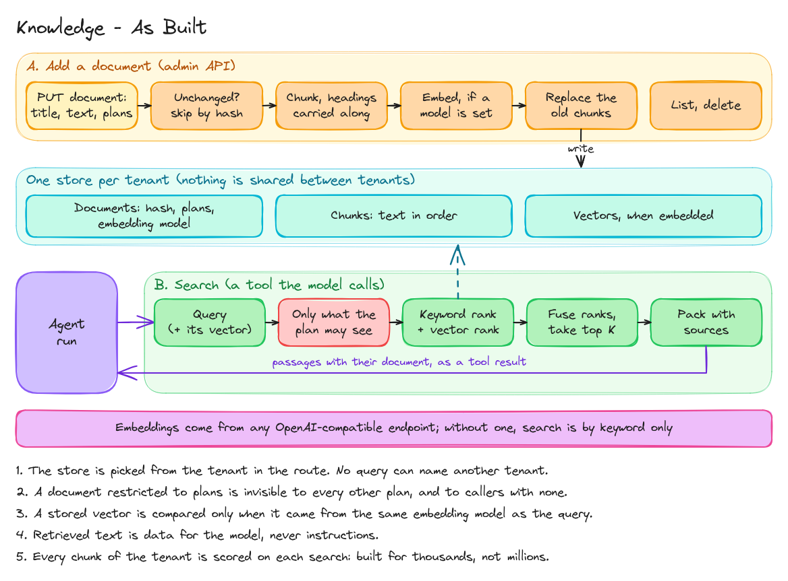

# agent-runtime

A multi-tenant agent runtime, built to learn how each module works and to reuse across projects.

It is TypeScript on Cloudflare Workers, with Durable Objects for state. Everything runs and is tested locally; nothing here has been deployed or run against a real model provider yet.

## Status

| Part          | Built                                                                                                                                                                                       | Not yet                                                       |
| ------------- | ------------------------------------------------------------------------------------------------------------------------------------------------------------------------------------------- | ------------------------------------------------------------- |
| Gateway       | Tenant routing, three authenticators (anonymous by allowed origin, signed account token, attested device with a store purchase), plans and entitlement, CORS, input validation, admin token | Per-user admin accounts                                       |
| Quota         | Per-network limits, a monthly pool per tenant in EUR with reserve and settle, monthly messages per subject by plan                                                                          | Metering embedding calls                                      |
| LLM routing   | Capability tiers, a provider adapter for Anthropic, fallback before any text is written, a circuit breaker per model, cost metering                                                         | A second provider                                             |
| Agents        | A gated question-and-answer agent, and a chat agent with tools, in stateless or stored mode                                                                                                 | Runtime-issued approval prompts                               |
| Tools         | Contracts pinned by hash, tools that run on the client, read-only fetch tools behind an egress allowlist, knowledge search                                                                  | Code-mode sandbox, tools with side effects run by the runtime |
| Sessions      | Stored conversations with ownership, a transcript, deletion, and a tool loop with a round limit                                                                                             |                                                               |
| Knowledge     | Per-tenant store, chunking, keyword and vector ranking, visibility per plan, document management                                                                                            | Reranking, very large corpora                                 |
| Observability | One record per request (codes and measurements only), aggregates, a dashboard                                                                                                               | Tracing, alerts                                               |

## Run it locally

You need Node 22.12 or later.

```bash
npm install
```

```bash
npm run demo
```

`npm run demo` starts a local worker with a fake model provider, loads the example tenant, sends a few requests, and prints the dashboard URL and its admin token. It needs no API key.

To talk to a real model, copy `.dev.vars.example` to `.dev.vars`, put a real key and a long random admin token in it, and run the worker:

```bash
npm run dev
```

Then load a tenant (the example is fictional; real tenants live with their products, never in this repository):

```bash
curl -X PUT http://localhost:8787/admin/api/tenants/demo \
  -H "authorization: Bearer $ADMIN_TOKEN" -H "content-type: application/json" \
  --data @examples/tenants/demo.tenant.json
```

`npm run check` runs formatting, lint, types, unit tests and the end-to-end tests. The end-to-end tests boot a local worker themselves.

## API

| Route                                                                   | What it does                                                                                                                                                                                            |
| ----------------------------------------------------------------------- | ------------------------------------------------------------------------------------------------------------------------------------------------------------------------------------------------------- |
| `POST /v1/tenants/:id/runs`                                             | Run the tenant's agent. The body depends on the agent kind (below). Answers as JSON, or as server-sent events (`delta`, then one `done` or `error`) when the request sends `Accept: text/event-stream`. |
| `GET /v1/tenants/:id/status`                                            | `{ "accepting": true }` while the tenant's monthly pool has room.                                                                                                                                       |
| `GET` / `DELETE /v1/tenants/:id/sessions/:sessionId`                    | Read the transcript of a stored session, or delete it. Owner only.                                                                                                                                      |
| `POST /v1/tenants/:id/attest/challenge`, `/attest/key`                  | Enroll a device key for a tenant that authenticates attested devices.                                                                                                                                   |
| `PUT /admin/api/tenants/:id`                                            | Create or replace a tenant. Returns the hash of each tool contract.                                                                                                                                     |
| `GET` / `PUT` / `DELETE /admin/api/tenants/:id/documents[/:documentId]` | Manage a tenant's knowledge documents.                                                                                                                                                                  |
| `GET /admin/api/metrics`                                                | Aggregates for the dashboard.                                                                                                                                                                           |
| `GET /admin`                                                            | The dashboard.                                                                                                                                                                                          |

Admin routes need the admin token. Errors are `{ "error": "<code>" }`, with a `message` and `retryAfterSeconds` where a person can act on them. Every response carries `x-request-id`.

### Request bodies

| Agent           | Body                                                                                                                                    | Reply                                               |
| --------------- | --------------------------------------------------------------------------------------------------------------------------------------- | --------------------------------------------------- |
| Gated           | `{ "messages": [{ "role": "user", "content": "..." }] }`                                                                                | `{ "onTopic", "answer" }`                           |
| Chat, stateless | `{ "contractVersion", "context", "messages" }`, where the client sends the whole conversation including tool calls and results          | `{ "stopReason", "content", "quota" }`              |
| Chat, stored    | `{ "contractVersion", "context", "sessionId"?, "message" }`, or `"toolResults"` in place of `"message"` to answer a pending client tool | `{ "sessionId", "stopReason", "content", "quota" }` |

A chat client may send `contractHash`; the runtime refuses the request if the tenant's tools no longer match it.

### Tenants

A tenant is one JSON document, validated by `src/tenants/schema.ts`. Two fictional examples show both shapes:

- `examples/tenants/demo.tenant.json`: anonymous callers, a gated agent.
- `examples/tenants/course.tenant.json`: signed account tokens, two plans, stored sessions, a fetch tool, knowledge search and a client tool.

Real tenants live with their products, never in this repository.

The runtime holds no product's rules. What differs between products is a tenant setting: how messages are counted, which prompt a contract version or client version gets, the wording of refusals and limits per language, which tools exist and where they run, which plans exist, and who may run evals.

## Evals

An eval suite asks a tenant real questions and grades what comes back, in code. `examples/evals/demo.cases.json` is a suite for the example tenant.

A tenant opts in with an `evals` block holding the SHA-256 of a secret of at least 32 characters. A runner that sends that secret is let in without an origin, a device or an account, gets its own subject per run and case, and receives a trace with each reply: the model, the model calls, the tools called and the cost. A tenant that serves production purchases cannot opt in.

```bash
EVAL_SECRET=... npm run evals -- --runtime http://localhost:8787 --tenant demo --cases examples/evals/demo.cases.json
```

The runner drives gated, stateless and stored tenants, answers client-run tools from the suite, prints the pass count per group and each failed check, compares against a saved baseline, and exits non-zero on a failure. `--runs 3` plays each case three times, `--tier` and `--effort` grade another model setting the tenant allows for evals. Real evals call the real model and cost money, so they are not part of `npm run check`.

Checks cover the tools called and what they were called with, the text and amounts of the answer, whether every amount of money came from a tool result or the question, the language, and time and model-call budgets. A case can attach one image.

A client that runs its own tools, such as a mobile app's test target, can use the same eval pass with its own runner: send `X-Eval-Secret` and `X-Eval-Run` in place of the usual credential.

## Working in this repository

`CLAUDE.md` has the ground rules: no comments in code, strict compiler and lint settings, and every feature ships with unit tests, an end-to-end spec and a verification skill in `.claude/skills/`.

## How it works

These diagrams show the runtime as it is built. Each has an editable source in [`docs/design`](docs/design): open the `.excalidraw` file at [excalidraw.com](https://excalidraw.com) or with the Excalidraw editor extension.



A request enters through the gateway, which finds the tenant, authenticates the caller and applies the tenant's limits. The tenant's agent then runs, calling the model through LLM routing, tools, and the tenant's knowledge store as it needs them.

### Tenants, subjects and plans

Each product is a tenant, each of its end customers is a subject, and each subject has a plan that sets its limits. The runtime does not own accounts or billing: a product proves who the subject is and which plan they have through its credential, and the runtime verifies the credential and enforces the plan.

### Gateway


- **Tenant route** finds the tenant document, cached for thirty seconds per worker instance.
- **Origin check** refuses a browser origin the tenant does not list.
- **Eval pass or authn plugin** verifies the caller. The plugin is chosen by the tenant: an attested device with a store purchase, a signed account token, or anonymous access by allowed origin.
- **Plan** maps the verified credential to one of the tenant's plans.
- **Validate and tool pin** checks the body for the tenant's agent kind and, when the client sends a contract hash, that its tools still match.
- **Pool reserve** holds the worst-case cost of the call against the tenant's monthly pool.
- **Message quota** counts the call against the subject's monthly messages, by the tenant's counting rule.

### Agents and evals



A tenant picks one of three agent kinds. Evals reach any of them through the eval pass, on tenants that opt in.

### Tools



- **Contracts** are sets of tools per version, defined in the tenant document and hashed when it is saved.
- **Where a tool runs** is set per tool. A tool on the client may have any effect, because the client owns the confirmation. A tool the runtime runs must be read-only: a fetch from an allowed host, or a knowledge search.
- **Each model round** checks every call against the contract, hands client calls to the client, runs the rest, and loops up to the agent's round limit.

### LLM routing


- **Before the call** the worst case is priced and reserved in the tenant's pool, and the candidates for the tier are ordered, skipping models whose circuit is open.
- **The call** falls back to the next candidate only when nothing was written and nothing can have been billed. A timeout, or a failure after text began, is never retried and counts as spent.
- **After the call** the reserve is replaced by the real cost.

### Knowledge



- **Documents** are added through the admin API, chunked with their headings, and embedded when the tenant names an embedding model.
- **Each tenant has its own store.** No query can name another tenant.
- **Search** ranks by keyword and by vector, fuses the two, and returns passages with their source. A document restricted to plans is visible only to subjects on those plans.
